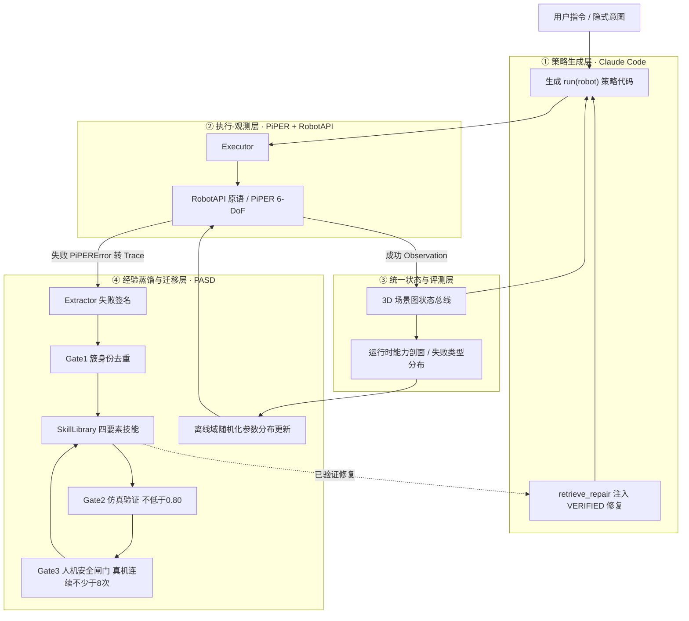

# 面向生活辅助的具身智能体系统研究

> 文档性质：研究方案 / 开题报告。依据工作区 5 篇中文文献、4 件专利著录截图，以及资料库中 PASD（失败签名驱动的经验蒸馏）系列构想文档撰写。文中「已复现」与「协议待跑」严格区分，未给出未经实验支撑的成功率数值。

## 摘要

面向桌面助餐与取物两类生活辅助任务，本文提出一套以 **PASD 失败签名经验蒸馏为核心记忆机制**、以 **Claude Code 编码型智能体 + AgileX PiPER 6-DoF 机械臂 + MuJoCo 仿真** 为可运行底座的具身智能体系统方案。五篇综述与近作共同指出：制约落地的已不是单一模型能力，而是「感知—决策—执行—反馈」闭环中状态表示、动作接口、失败信号与评测口径的不统一，以及三维空间感知缺失、长时序失败不可归因、Sim-to-Real 落差不可度量。已有四件国内专利分别覆盖训练数据生成、任务执行、轨迹预测与在线更新，但均未主张感知表征、评测诊断与迁移训练，构成本研究的布局空间。

方案的核心推进有三点：其一，把 PASD 的失败签名从「抓取物理失败」扩展为**任务级 / 交互级 / 安全级失败**，并在原有双闸门之上增设**人机共域安全闸门**；其二，用**统一状态总线（3D 场景图）与运行时评测协议**补齐三处断裂接口，使「语义合理但物理不可行」的规划在下发前被拦截；其三，把评测输出的**失败类型分布**转化为**离线训练阶段的仿真随机化参数分布更新**，形成可度量的自进化闭环。文中给出两个典型任务的子目标链、失败签名样例、指标体系、消融与专利划界。PASD 已有实证为 240 次失败收敛至 9 个同质簇（纯度 1.0、去重率 96%）、FTR 15%–26%；端到端、消融、泛化与真机实验目前为已固化协议，尚待执行。

**关键词**：具身智能体；生活辅助；失败签名；经验蒸馏；code-as-policy；PiPER；人机共域安全；统一评测协议；Sim-to-Real

---

## 1　研究背景与意义

### 1.1 场景需求

进食辅助与桌面取物是日常生活活动（ADL）中频率最高、对可靠性最敏感的两类操作。与工业抓取相比，它们具有四个特殊性：

| 特性 | 具体表现 | 对系统的要求 |
|---|---|---|
| 人机共域 | 末端需接近用户面部、手部 | 安全距离、限速、力限、可随时中断 |
| 对象非结构化 | 餐具、食物、水杯、药盒形态与材质差异大，含液体与易洒漏物 | 几何与可供性联合表征，倾倒角与fill level 约束 |
| 指令模糊 | 「我有点渴」「喂我一口」不指定物体 | 隐式意图解析与指代消解，必要时反问澄清 |
| 失败代价高 | 碰撞、烫伤、洒漏、误取药物 | 失败必须可归因、可恢复，且不允许「带病晋升」 |

### 1.2 文献共识：从模型能力转向闭环可靠性

- 李道童等明确把研究目标从「能否完成任务」推进到「能否稳定完成任务」，并指出**接口一致性**（状态表示、动作接口、时间同步机制、失败信号定义、回退触发条件缺乏统一规范）是部署不稳定的根源；同一研究把过程稳定性、失败恢复能力、安全代价列入评测维度 [5]。
- 曹群等把「缺乏涵盖三维空间感知、跨任务泛化及物理操作性能的通用标准化基准」「VLM 的 3D 空间直觉」「自主反思与终身学习、灾难性遗忘、增量式知识更新」列为三个持续创新方向 [3]。
- 李颂元等把仿真环境与现实之间的 domain gap 视为部署的主要障碍，并指出评估协议繁复使真实世界方法难以横向比较 [2]。
- 安冉等以图世界模型 + 语义引导 MCTS + **状态校验与顺序反馈**缓解长程任务稀疏奖励，并给出可直接复用的 SR / ET / CR 评测协议 [4]。
- 张昌盛从生成认知与主动推理（自由能原理、MILS、马尔科夫毯、三维物理形态约束）给出「预测—观测差异最小化」的理论闭环，为「感知—校正—更新」提供哲学与机制依据 [1]。

### 1.3 已有专利与 PASD 构想的定位

四件国内发明专利（据万方著录截图）恰好铺开一条「数据 → 执行 → 轨迹 → 运维」链，但都没有主张感知表征、评测诊断与迁移训练：

| 专利 | 申请号 / 公开(公告)号 | 申请人 | 技术落点 | 与本课题关系 |
|---|---|---|---|---|
| 具身智能体训练系统及方法 | CN202410222939.6 / CN118194966B | 清华大学 | LLM 生成任务 + 虚拟环境求最优控制序列 + 自动标注 → 训练 VLA | 数据上游，可复用其自动标注思路 |
| 具身智能体的任务执行方法 | CN202510119277.4 / CN120134299A、B | 人形机器人(上海)有限公司 | 语音/历史 → 预测动作 → 候选任务 → 环境消歧 → 执行检测 | 执行环；FTO 必须以 B 文本为准 |
| 多模态具身智能体轨迹预测方法 | CN202511484525.1 / CN121635096A | 杭州联汇科技股份有限公司 | 编码器—融合器—解码器 + 高斯噪声 + GRU 生成带概率轨迹假设 | 可作孪生 rollout 的候选轨迹生成器 |
| 具身智能体更新方法、装置及设备 | CN202610938804.9 / CN122735765A | 鹏城实验室 | 物理/孪生偏差 → 增量数据 → 在线微调 → 预执行验证 → 风险评分 → TSN 原子切换 | 部署侧闸门；本课题须与之划界 |

资料库中的 PASD 构想已经给出一套**免训练、模型无关、以失败签名为接口**的确定性记忆层：把一次失败 Trace 蒸馏为 ⟨σ, C, π, V⟩ 四要素技能，用 Gate1 簇身份去重与 Gate2 仿真验证保证精炼与可信，并以 Claude Code（策略生成）+ PiPER（执行）+ 持久化经验库给出可运行实例化 [6][7][8][9]。但 PASD 目前的任务族仍是**单臂多样性抓取**，错误码集中在 `GRASP_SLIP`、`POSE_LOW_CONFIDENCE`、`IK_UNREACHABLE`、`GRASP_IMPOSSIBLE` 四类物理失败。

**本研究的定位**：把 PASD 从「抓取技能自学习方法」提升为「面向生活辅助的系统级自进化方法」，并把此前识别出的三个空白方向（三维空间感知与 3D VLM、统一评测基准与协议、Sim-to-Real 域随机化）作为**闭环中的接口**而非外挂模块来设计。

---

## 2　研究现状与关键问题

### 2.1 五篇文献的技术脉络与本课题支撑

| 文献 | 核心观点 | 对本课题的支撑 |
|---|---|---|
| 张昌盛，2024，北京工业大学学报(社科版) 24(6) [1] | 生成认知、主动推理 / 自由能原理、MILS、马尔科夫毯、具身智能体的 3D 物理形态约束 | 「预测—观测—校正」闭环的理论依据；强调形态对信息处理的硬约束 |
| 李颂元等，2025，浙江大学学报(工学版) 59(2) [2] | 基座模型、决策 Transformer / 轨迹 Transformer、仿真平台谱系、domain gap、Sim-vs-Real 相关系数 | 迁移训练的度量口径与分布差异来源 |
| 曹群等，2026.01，自动化博览·具身智能专刊 [3] | 大脑—小脑分层与信号传递、自主化数据生成、3D 空间直觉、异构能力统一评估框架、终身学习 | 分层架构与空白清单 |
| 安冉等，2026，控制与决策（网络首发 2026-10-29）[4] | 图世界模型 + 语义引导 MCTS + 子目标状态顺序校验 + 子目标/终端奖励融合；SR/ET/CR 协议 | 规划层状态校验机制与可复用评测协议 |
| 李道童等，2026，中国工程科学 28(5) [5] | 接口一致性、长时序失败恢复、评测体系与公开基准、域随机化主流地位、安全代价、VLA 端到端瓶颈 | 工程约束、过程性评测维度、透明迁移协议清单 |

### 2.2 三个尚未解决的关键问题

**P1　接口断裂。** 状态表示、动作接口、时间同步、失败信号定义、回退触发条件缺乏统一规范；即使各模块单独测试良好，联调与长期运行仍不稳定 [5]。四件专利中的「当前环境数据」「物理/预测状态」「轨迹假设」是三套互不通用的私有表示。

**P2　失败不可归因。** 现有 code-as-policy 记忆多为轨迹级存储或自然语言反思（Voyager / Reflexion），只有「成功/失败」二值标签，无法回答「在哪一环、因何条件失败」[6]。而生活辅助是长时序任务，失败多表现为抓取偏差、状态漂移、时序不一致的**逐步累积**，不是单次明显错误 [5]。

**P3　评测不可比、迁移不可控。** 单一成功率掩盖误差传播与恢复能力差异 [5]；仿真性能差异在部署后并不一致，需微调模拟器参数 [2]；随机化范围、真实数据微调比例、传感器噪声建模、动作接口重参数化、seen/unseen 划分目前多靠人工设定，缺乏由实机偏差驱动的闭环 [5]。

---

## 3　研究目标与研究内容

### 3.1 总体目标

构建一套**可运行、可评测、可自进化**的桌面生活辅助具身智能体：在 PiPER + Claude Code + MuJoCo 实物/仿真平台上稳定完成桌面助餐与取物，具备三维状态表征、任务级失败归因、运行时过程诊断、失败分布驱动的迁移训练与人机共域安全保证。

### 3.2 研究问题

| 编号 | 研究问题 | 判据 |
|---|---|---|
| RQ1 | 任务级失败签名能否在生活辅助长时序任务中保持低冗余与强归因 | 库规模压缩率、簇纯度、可定位环节占比 |
| RQ2 | 双闸门 + 安全闸门能否在人机共域下拦截假经验与不安全修复 | 假晋升率、安全违规次数、不可修复模式的正确拒止 |
| RQ3 | 统一评测协议能否诊断过程稳定性并驱动重规划 | 「结果成功但过程不稳」检出率、局部重规划成功率 |
| RQ4 | 失败类型分布驱动的自适应域随机化能否收窄 sim→real 落差 | SRCC、真实域成功率、长尾失败率、收敛所需真实样本数 |

### 3.3 研究内容

- **W1　统一状态表示与接口协议**：3D 场景图状态总线 + 六项接口规范（状态 / 动作 / 时基 / 失败信号 / 回退触发 / 日志），并落实白名单 API 与开发集—留出集隔离。
- **W2　任务级 PASD**：扩展签名触发维度与错误码、增加交互与安全环节、增设 Gate3 安全闸门、支持向上蒸馏与跨任务复用。
- **W3　运行时统一评测与诊断**：SR/ET/CR + 过程性指标 + 安全代价归一化，孪生 rollout 前置可行性评分，诊断结果触发重规划或回退。
- **W4　失败分布驱动的迁移训练与安全部署**：离线仿真参数分布更新、真机验证闸门、与在线更新类专利的边界设计。

---

## 4　系统总体方案

### 4.1 硬件与软件栈

| 层 | 配置 | 关键约束 |
|---|---|---|
| 执行 | AgileX PiPER 6-DoF，额定负载 1.5 kg，工作半径 626.75 mm，重复定位精度 ±0.1 mm；两指夹爪 0–70 mm、精度 ±0.5 mm、额定夹持力 40 N；CAN 通信，piper_sdk / piper_ros（ROS 1/2），支持拖动示教 | 6-DoF 无零空间；`solve_ik` 返回空即 `IK_UNREACHABLE`；`target_width > 0.070` 直接判 `GRASP_IMPOSSIBLE` |
| 感知 | RGB-D 相机 → 分割 → 点云后处理 → 6D 位姿 → 抓取候选；可选 3D 场景图层 | 只用真机同样可得的观测量，禁止访问仿真真值 |
| 智能体 | Claude Code（code-as-policy），仅允许调用 `RobotAPI` 白名单原语：`move_to_pose` / `open_gripper` / `close_gripper` / `get_observation` / `solve_ik` | 规划前先 `retrieve_repair` 注入已验证修复 |
| 仿真 | MuJoCo（piper_ros / CAD 导出 MJCF），离屏 RGB-D，并行多环境 rollout，接触丰富场景建议 implicitfast、步长 1–2 ms | 夹持力上限与指面摩擦系数需用真机「逐步降低夹持力直到滑落」标定，是最大仿真不确定性来源 |
| 记忆 | PASD `SkillLibrary`（跨会话持久化）、`OnlineClusterer`、`Retriever`、`Extractor` | 与仿真/真机共用同一 `RobotAPI` 抽象 |
| 安全 | 速度/加速度限幅、工作空间盒约束、力矩上限、急停与 Watchdog、人体检测、新技能先仿真后真机 | 轻量臂执行语言模型生成代码属高危操作，约束必须外挂在控制层 |

### 4.2 四层架构与闭环

三层职责与 PASD 原构想一致：策略生成层产出受约束的策略代码；执行—观测层把成功包装为 `Observation`、失败包装为结构化 `Trace(task, error_code, message, features, scene, policy)`（PASD 的唯一输入）；经验蒸馏层完成提取、去重、验证与回流。本研究新增第三层，把状态与评测从「各模块私有日志」提升为**全系统共享总线**，并把第四层从「记忆」扩展为「记忆 + 迁移训练」。

关键性质是**闭环自改进**：本次会话蒸馏的失败，下一会话 `retrieve` 仍可检索；经验库是累积资产而非一次性日志。

### 4.3 统一接口协议（把文献 [5] 七(六) 落地）

| 规范项 | 本系统定义 |
|---|---|
| 状态表示 | 3D 场景图节点：`object_id` / `pose` / `affordance` / `confidence` / `timestamp`；规划、校验、评测共用 |
| 动作接口 | `RobotAPI` 五个原语，参数统一 SI 单位（夹爪开度用米，`0.022` 表示夹住 22 mm 物体而非失败量） |
| 时间同步 | 统一时基与帧号，传感、控制、日志、Trace 对齐；控制频率显式写入任务配置 |
| 失败信号 | `error_code` + `stage`（感知/规划/执行/验证/交互/安全）+ 白名单 `features` 字典 + 自然语言 `description` |
| 回退触发 | 分级回退表：重感知 → 局部重规划 → 换策略 → 安全停机 → 请求人工 |
| 日志格式 | 全链路 `Trace` 落盘，含逐原语输入/输出/耗时/关键帧/错误码 |

两条防污染约束必须硬编码：**白名单 API** 只允许记忆层读取真机同样可观测量（RGB、深度、分割、位姿、关节状态、夹爪状态、错误码），禁止任何仿真真值；**开发集 / 留出集隔离**，只有开发集失败可以驱动技能库更新，留出集失败只记录、不回写。

### 4.4 由 PiPER 物理语义导出的硬规则

| 现象 | 规则 | 处理 |
|---|---|---|
| 6-DoF 无零空间 | 不能用「冗余角搜索」生成可行解 | 多起点阻尼最小二乘 IK + 目标姿态可达性预筛 + `IK_UNREACHABLE` 降级 |
| 细长物体顶抓必滑 | `aspect_ratio > 4` | 侧夹 + 手腕倾斜（这正是需要蒸馏的修复 π） |
| 夹爪量程 0–70 mm | `target_width > 0.070` | `GRASP_IMPOSSIBLE`，不硬夹 |
| 夹持证据 | 稳定开度约等于物体宽；空抓约等于 0 | 用开度 + 闭合时电流上升超过空载基线联合判定，10 mm 级分辨率足够，1 mm 级不可靠 |
| 真机复位 | 真机实验吞吐瓶颈几乎全在复位 | 固定料仓、限位工装或脚本化重置，任务须能自动判定成功且自动复位 |

---

## 5　关键技术

### 5.1 任务级失败签名与三闸门蒸馏（对 PASD 的实质扩展）

**原有签名结构** [6]：三类触发条件 `trigger_geom`（如 `aspect_ratio > 4`）、`trigger_percept`（如 `pose_confidence < 0.6`）、`trigger_env`（如 `workspace_radius > 0.4`），加 `stage` 与 `description`；匹配采用硬匹配闸门——缺项不否决、命中即触发、有向取整余量（`>` 向下取整、`<` 向上取整，修复缺陷 D9）；空签名不入档，防止退化出「万能技能」。技能为 ⟨σ, C, π, V⟩ 四要素，π 同时含给 Claude Code 读的自然语言修复建议与给 Executor 跑的机器可执行修复。

**本课题扩展**：

| 扩展项 | 内容 |
|---|---|
| 新增触发维度 | `trigger_human`（用户口部/手部位置、注意状态、意图置信度）、`trigger_task`（子目标序号、已完成占比、指令类型）、`trigger_safety`（最小人机距离、末端速度、接触力、食物温度） |
| 新增环节 | `stage` 由四类扩为六类：新增**交互**、**安全** |
| 新增错误码 | `FOOD_SPILL`、`UTENSIL_SLIP`、`MOUTH_APPROACH_UNSAFE`、`INTENT_AMBIGUOUS`、`OCCLUSION_RETRIEVE_FAIL`、`PLACEMENT_OFFSET`、`SAFETY_VIOLATION` |
| 验证记录 V 扩展 | 追加最小人机距离、最大接触力、急停/中断次数、安全评分 |
| 三闸门 | Gate1 簇身份去重（身份键 `stage + error_code + 簇ID`，聚类半径 0.45）→ Gate2 仿真实测 10 次中不少于 8 次成功（阈值 0.80）→ **Gate3 人机安全闸门**（真机连续不少于 8 次成功 + 外力/距离约束通过 + 首次上线人工确认） |

状态机：`Trace → CANDIDATE → VERIFIED → DEPLOYED`；空签名、仿真未达标或安全未通过转 `REJECTED`。对 `IK_UNREACHABLE`、`GRASP_IMPOSSIBLE`、`INTENT_AMBIGUOUS` 这类**单臂不可自主修复**的模式，`propose_repair` 返回空并转人工，Gate2/Gate3 必然不晋升——这是正确行为，不应强行修复。

**已复现基线** [7]：朴素量化仅把 240 次失败去重到 211 条（12%），簇身份去重收敛为 **9 个同质簇、纯度 1.0、去重率 96%**；FTR（失败转修复率）**15%–26%**；有向取整修复 D9 后签名自命中率由 100% 降至 75%。**端到端成功率、消融、泛化、真机验证（E3–E6）目前为已固化协议，数值待大模型与真机接入后填充**，本报告不预设结果。

### 5.2 三维场景图与动作可行性约束

多视角 RGB-D 与语言指令构造「物体—位姿—可供性」三元组监督，把体素/3D 高斯 token 注入冻结的 2D VLM、只训练几何适配层，输出带位姿、可供性与置信度的 3D 场景图；按「预测—观测」差异触发**局部重投影与置信度增量更新**，避免全图重建以适配边缘算力（呼应 [1] 的主动推理思想）。规划器在该统一表示上做可达性、遮挡与人机距离约束，**在子目标生成阶段过滤「语义合理但物理不可行」的规划**（承接 [4] 的状态校验）。

> 与 CN120134299B 的划界：该授权文本权 1 已把「多次傅里叶变换生成频域信号与文本配对、冻结视觉编码器/语言模型、更换投影器激活函数、增加标准化层」列为调整操作。本方案若采用冻结 2D 骨干，必须在**几何监督信号、适配层位置或训练目标**上做出实质区别，避免落入其字面范围。

### 5.3 统一评测协议与运行时诊断

**基础指标**沿用 [4]：SR（30 步内成功完成的指令占比）、ET（输入指令到动作序列结束耗时）、CR（已完成子目标占全部子目标比例）；三类指令（简单 7 条、隐式 4 条、组合 13 条），每条独立 50 回合，报告均值 ± 样本标准差。

**过程性维度**按 [5] 七(四) 扩展：过程稳定性、执行效率、失败类型、恢复能力、跨场景泛化、跨平台迁移、安全代价。可观测信号包括子目标完成率、中间状态校验结果、失败发生位置/类型、恢复尝试次数、局部重规划成功率、执行耗时、最小人机距离、最大接触力、洒漏率。

系统在运行时把上述信号归一化为**能力剖面**，与基准阈值比较后输出诊断，触发重规划或分级回退，并支持「结果成功但过程不稳」的判定；规划下发前用数字孪生/世界模型 rollout 统计物理不可行步骤占比，无需实机即可给出前置可行性评分。由此把评测从离线打分变成闭环的反馈信号。

> 客体适格性提示：纯评分规则易被认定为智力活动的规则和方法。撰写与申请时必须绑定技术数据（传感日志、控制指令、仿真 rollout）与技术效果（降低实机测试成本、提升部署安全性），并同步布局「评测系统/装置 + 计算机可读存储介质」权利要求。

### 5.4 失败类型分布驱动的自适应域随机化

评测输出的**失败类型分布**自动转换为仿真随机化参数的分布更新：滑移、遮挡、碰撞、恢复等关键状态对应的仿真样本被重加权，随机化维度覆盖物体尺寸/长宽比/质量、摩擦、相机外参抖动、光照纹理、背景杂物、传感器噪声与执行延迟；收敛后输出参数分布用于批量训练，训练前以 Sim-vs-Real 相关系数（SRCC 类指标）预测可迁移性，低于阈值则阻止部署并回到再随机化。这是 [2] 中「仿真性能差异部署后不一致、需微调模拟器参数」的自动化版本，并落实 [5] 七(二) 的透明迁移协议清单。

> 与 CN122735765A 的划界（**必须严格遵守**）：该专利已主张「物理状态与孪生预测状态偏差 → 生成增量训练数据 → 策略网络在线增量微调 → 孪生体预执行验证 → 综合风险评分 → 时间敏感网络空闲时隙原子化切换推理指针」。本方案须在权利要求中明确限定为**离线训练阶段的仿真参数分布更新**，并排除「增量训练数据 → 在线微调 → 推理调用指针切换」要素，否则可能构成抵触申请或缺乏创造性。

### 5.5 人机共域安全闸门（生活辅助特有）

| 层 | 措施 |
|---|---|
| 规划层 | 工作空间盒、用户面部禁入区、口部安全距离、末端速度上限、餐具倾角与盛装量上限 |
| 控制层 | 力/位限幅、软夹持、Watchdog、急停、人体接近检测 |
| 验证层 | 仿真先行 → 真机连续不少于 8 次 → 首次上线人工陪同 → 中断即分级回退 |

助餐特有约束：不接触口部、食物温度确认、洒漏即停、用户语音随时可中断、意图置信度不足时反问而非猜测。所有安全违规一律写入 `SAFETY_VIOLATION` 签名且不得晋升为可自主修复技能。与 CN122735765A 的关系是**上游训练/任务闸门 vs 下游部署闸门**的互补，宜做专利族与交叉许可，而非重复申请。

---

## 6　典型任务实现

### 6.1 桌面助餐

**指令示例**：「帮我喝点汤」（隐式）、「把水杯递到嘴边」（简单）、「先舀一勺再递过来」（组合）。

**子目标序列**：意图解析 → 目标定位（碗/勺/杯）→ 姿态、盛装量与温度确认 → 可达性与人机距离预检 → 餐具抓取 → 舀取/倾倒 → 送递至口部安全区 → 状态确认 → 撤回与复位。

**状态字段**：`utensil_pose`、`fill_level`、`food_temp`、`human_mouth_pose`、`min_human_dist`、`gripper_width`、`pose_confidence`、`subgoal_idx`。

**失败签名样例**：

| 错误码 | 环节 | 触发条件（有向取整后的阈值） | 修复策略 π | 闸门处置 |
|---|---|---|---|---|
| `FOOD_SPILL` | 执行 | `tilt_angle` 超阈值 或 `fill_level` 偏高 | 降低倾角、分次少量、更换容器 | Gate2 仿真重跑 → Gate3 安全确认 |
| `UTENSIL_SLIP` | 执行 | `aspect_ratio > 4` 且 `approach = top` | 侧夹 + 手腕倾斜 | Gate2 达标晋升 |
| `MOUTH_APPROACH_UNSAFE` | 安全 | `min_human_dist` 低于阈值 或 末端速度超阈值 | 降速 + 重规划接近方向 + 扩大安全区 | 强制 Gate3，未过不晋升 |
| `INTENT_AMBIGUOUS` | 交互 | `intent_confidence < 0.6` | 反问澄清，把隐式指令转为具体指令 | 转人工，不自动晋升 |
| `POSE_LOW_CONFIDENCE` | 感知 | `pose_confidence < 0.6` | 重感知 / 换视角 / 补深度 | Gate2 以 `scene_patch` 验证 |
| `IK_UNREACHABLE` | 规划 | `solve_ik` 无解 | 调整餐具摆位或请求协助 | 保持 `CANDIDATE`，禁止晋升 |

### 6.2 取物

**三类指令**：简单（「把水杯拿给我」）、隐式（「我有点渴」）、组合（「把药盒和温水一起放到我右手边」）。

**子目标序列**：意图/指代消解 → 场景图检索目标 → 可达性与遮挡过滤 → 路径与避障 → 抓取 → 搬运 → 放置到指定区 → 状态确认。每一子目标带 `completed` 标志并做**顺序校验**（[4] 的图世界模型机制），前序未完成不得推进，防止级联失效。

**失败签名样例**：`OCCLUSION_RETRIEVE_FAIL`（`occlusion_ratio` 超阈值 → 先移开遮挡物）、`GRASP_IMPOSSIBLE`（`target_width > 0.070` → 换夹持策略或换目标）、`PLACEMENT_OFFSET`（`placement_error` 超阈值 → 重定位再放）、`DETECTION_FAILED`（`depth_valid_ratio` 偏低 → 重感知）、`SAFETY_VIOLATION`（人机距离/接触力越界 → 停机回退）。

### 6.3 跨任务复用与向上蒸馏

两任务共享 `POSE_LOW_CONFIDENCE`、`GRASP_SLIP`、`IK_UNREACHABLE` 等**与本体无关**的签名，可直接验证 RQ4 的零样本迁移（未见物体、跨任务）。当「细长物体侧夹」「低置信重感知」等低层技能在多个任务中频繁协同命中时，按 `tag` 与 `hits` 抽象为更高层的「细长易滑物体操作套路」，实现从单点修复到组合策略的向上蒸馏 [6]。

---

## 7　实验设计与评测体系

### 7.1 平台与任务族

| ID | 任务 | 主要失败环节 | 参数化难度轴 | 目标错误码 |
|---|---|---|---|---|
| T1 | 细长抓取（圆柱/酒瓶）—抬升—放置 | 执行 | 长宽比 1–12、直径 10–40 mm、质量 20–300 g | `GRASP_SLIP` |
| T2 | 扁平薄片操作（抓取失败→推动替代） | 执行 | 厚度、表面摩擦 | `GRASP_IMPOSSIBLE` |
| T3 | 桌边/障碍侧向趋近抓取 | 规划 | 障碍距 0–60 mm、目标朝向 | `IK_UNREACHABLE` |
| T4 | 低纹理/透明/反光物体抓取 | 感知 | 深度缺失率、光照 | `POSE_LOW_CONFIDENCE`、`DETECTION_FAILED` |
| T5 | 堆叠/遮挡下目标抓取 | 感知 | 遮挡比例 0–70% | `DETECTION_FAILED` |
| T6 | 桌面指定区放置 | 验证 | 目标区尺寸 20–100 mm | `PLACEMENT_OFFSET` |
| T7（OOD） | 未见任务：插孔 / 开抽屉 / 倒水 | 混合 | — | — |
| A1 | 桌面助餐（三类指令） | 交互/安全/执行 | 食具形态、盛装量、用户位姿 | `FOOD_SPILL` 等 |
| A2 | 桌面取物（三类指令） | 感知/规划/验证 | 遮挡、放置精度、指代模糊 | `OCCLUSION_RETRIEVE_FAIL` 等 |

每个任务必须能自动判定成功（无需人工标注）并支持自动复位。

### 7.2 对比方法与消融

- **记忆结构**：No-Memory（下界）/ Trajectory Storage / Episodic Replay / PASD 原版 / 本系统。
- **算法范式**：Reflection（Voyager·Reflexion 式）/ VLA 端到端（OpenVLA·RT-2 类）/ 失败驱动（NEERL·APR·SSS）/ 技能学习（AIIFS·uniskill·ARMADA·TAG·IROSA）。
- **消融**：去 Gate1（朴素量化→211 膨胀）、去 Gate2（无验证）、**去 Gate3（无安全闸门）**、去任务级签名扩展（退回抓取四错误码）、去有向取整（D9 复发）、去评测驱动随机化（固定均匀采样）。

### 7.3 指标体系

| 类别 | 指标 | 定义 / 来源 |
|---|---|---|
| 任务 | SR、ET、CR | 30 步内成功占比、执行耗时、子目标完成占比 [4] |
| 蒸馏 | FTR、去重率、簇纯度、假晋升率 | 失败转 VERIFIED 修复比例、库规模压缩、目标纯度 1.0、无 Gate2 时混入的无效修复占比 [7] |
| 检索 | precision@k、误触发率、蒸馏时延、存储增量 | 记忆层开销与可信性 [7] |
| 过程 | 中间状态校验通过率、失败位置/类型分布、恢复尝试次数、局部重规划成功率 | 从「能否完成」到「能否稳定完成」[5] |
| 安全 | 最小人机距离、最大接触力、急停/中断次数、洒漏率、安全违规晋升拦截数 | 本课题新增 |
| 迁移 | SRCC、仿真—真实成功率落差、长尾失败率、收敛所需真实样本数 | domain gap 可度量 [2] |

### 7.4 协议与统计口径

每方法在同一任务套件各跑 200 episode 绘制 SR–episode 学习曲线；生活辅助任务按 [4] 的三类指令各 50 独立回合、30 步上限，报告均值 ± 样本标准差；固定随机种子、公开训练/测试划分与数据预算；全链路 Trace 落盘；开发集失败可写库、留出集只记录；白名单 API 禁止仿真真值污染；仿真与真机共用同一 `RobotAPI` 抽象，保证「仿真里能跑的技能，真机上也能跑」。

### 7.5 可证伪判据

| 主张 | 判据 | 当前状态 |
|---|---|---|
| 低冗余且强归因 | 库规模压缩不少于 90%、簇纯度不低于 0.95、失败环节可定位率 100% | E2 已在参考实现复现（96%、1.0） |
| 失败可蒸馏为可用修复 | FTR 不低于 15%、假晋升率不高于 5% | FTR 已复现 15%–26%；假晋升率待 E4 |
| 端到端有效 | 助餐/取物 SR 与过程稳定性显著优于 No-Memory 与轨迹存储 | E3 协议已固化，待执行 |
| 泛化 | 未见物体零样本成功率显著优于轨迹存储 | E5 协议已固化，待执行 |
| 迁移 | SRCC 提升、sim→real 落差收窄、长尾失败率下降 | E6 与 5.4 节协议已固化，待执行 |

**不得把「预期趋势」写成实验结果**：PASD 文档中 E3–E6 明确标注为「协议 + 预期」，本方案沿用该口径。

---

## 8　创新点与专利布局

### 8.1 创新点（按「接口耦合」口径检验）

判断口径：耦合后是否出现**任一单模块无法实现的技术效果**。仅把 2D VLM 换成 3D VLM、或给系统加一张评分表，属模块替换，不构成可申请的创新。

| 编号 | 创新点 | 层级 | 新技术效果 |
|---|---|---|---|
| I1 | 任务级/交互级/安全级失败签名 + 三闸门蒸馏 | L2→L3 | 长时序、人机共域失败可归因、可验证、可拒止 |
| I2 | 统一 3D 场景图状态总线与运行时评测协议 | L2 | 跨模块状态一致，「语义合理但物理不可行」在生成阶段被拦截 |
| I3 | 评测失败类型分布 → 离线仿真参数分布更新 → 再训练 | L3 | 随机化范围不再人工调参，长尾失效随迭代收敛 |
| I4 | 人机共域安全闸门与不可自主修复模式的自动分诊 | L2 | 假经验与不安全修复无法进入执行环 |

四者串成自进化闭环：3D 场景图提供可校验状态 → 孪生 rollout 前置评分 → 执行日志归一化为失败类型分布 → 分布驱动域随机化再训练 → 新策略先仿真验证、按安全评分上线 → 上线后的物理/预测偏差回流，更新场景图置信度。3D 感知只给表示、评测只给分数、随机化只给数据，只有耦合才产生「持续自进化」。

### 8.2 拟布局专利与划界

| 拟申请 | 权 1 要素骨架 | 必须避开的现有技术 |
|---|---|---|
| P-A 任务级失败签名生成与人机安全验证方法 | 多源触发条件提取 → 六环节定位 → 簇身份去重 → 仿真验证 → 安全闸门 → 仅注入已验证修复 | CN120134299B 的频域训练数据与冻结/投影器改造；CN122735765A 的在线微调与指针切换 |
| P-B 统一状态表示与运行时评测系统 | 读取传感/控制/状态校验日志 → 多维归一化 → 能力剖面 → 阈值比较 → 触发重规划或回退 | 需绑定技术数据与技术效果，规避客体问题；同步布局装置/设备/存储介质 |
| P-C 失败类型分布驱动的仿真参数更新方法 | 采集真实轨迹 → 计算仿真/真实分布差异 → 依失败类型重加权并更新随机化分布 → 批量训练 → 收敛输出 | 严格限定离线训练阶段，排除 CN122735765A 权 1 全链 |
| P-D 3D 场景图驱动的动作可行性校验方法 | 多视角观测 → 3D token 化 → 语言对齐 → 输出带位姿/可供性场景图 → 子目标生成阶段过滤不可行规划 | PerAct / GWM / ReViWo 及两篇 2026 综述已公开 3D 表征 + VLM，须落在「低成本冻结 + 增量更新 + 可行性闭环」组合 |

与四件既有专利共同构成「数据生成 → 任务执行 → 轨迹预测 → 在线更新」加「感知表征 → 评测诊断 → 迁移训练」的完整链条，宜以专利族与交叉许可方式组织。

### 8.3 风险提示

- **A/B 文本差异**：CN120134299A 权 1 范围很宽，B 文本授权时把频域训练数据、冻结视觉编码器/语言模型、投影器激活函数与标准化层并入权 1。做 FTO **必须以 B 文本为准**，并注意审查历史中的禁反言。
- **抵触申请风险**：曹群等综述（2026.01）已公开「终身学习 / 增量更新 / 从失败中学习」，早于鹏城申请日（2026-06-26），是评价其创造性的关键对比文件；安冉等论文 2026-10-29 网络首发晚于四件专利申请日，不影响它们新颖性，但会成为此后申请的障碍。
- **撰写风险**：既有四件专利普遍「重限定」（写死 Transformer + 交叉熵、编码器/融合器/解码器 + 高斯噪声 + GRU、数字孪生 + 风险评分 + TSN 原子切换），换组件即可规避且多为内部流程、侵权取证难。新申请宜把必要技术特征上提为功能性表述，并补齐装置、设备、存储介质、系统侧权利要求。
- **边界**：以上「空白」是相对所给 5 篇文献与 4 件专利截图而言，未做外部专利数据库检索；A/B 状态依公开号后缀推断，需以国知局登记簿核验。

---

## 9　可行性、风险与实施计划

### 9.1 可行性

硬件（PiPER + SDK + ROS + MuJoCo MJCF）、智能体（Claude Code + `RobotAPI`）、记忆层（PASD 可运行实现）三套底座齐备；文献与专利已给出技术边界与 FTO 参照；E1/E2 已有可复现实证。主要不确定性是**夹持力与摩擦的仿真标定**（最大仿真不确定性来源）、**Claude Code 生成 `repair_plan` 的质量**（直接影响 Gate2 通过率，构成外部效度边界）与**真机复位吞吐**。

### 9.2 风险与对策

| 风险 | 表现 | 对策 |
|---|---|---|
| 人机安全 | 末端接近面部、洒漏、误触 | 三层安全闸门 + 首次人工陪同 + 不可自主修复转人工 |
| 生成质量 | 修复方案与失败不对因 | Gate2 先校验 `repair_plan.fixes == error_code`，否则直接拒绝 |
| 仿真失真 | 摩擦/力限未标定导致 Gate2 假晋升 | 真机「降力至滑落」标定 + 真机连续不少于 8 次二阶保证 + SRCC 监测 |
| 经验污染 | 仿真真值泄漏、留出集回写 | 白名单 API + 开发/留出隔离 |
| 客体与创造性 | 评测规则被认定为智力活动规则；3D VLM 学术拥挤 | 绑定技术数据与技术效果；新方案落在耦合组合而非单一模块 |

### 9.3 实施阶段

| 阶段 | 主要工作 | 交付 |
|---|---|---|
| M1 接口标准化 | 统一 3D 场景图状态表示、六项接口规范、Trace/日志格式、白名单 `RobotAPI` | 接口规范 v1、仿真—真机一致性测试 |
| M2 任务级 PASD | 扩展签名维度/错误码、Gate3 安全闸门、A1/A2 任务实现、自动成功判定与复位 | 可运行系统 v1、签名样例库 |
| M3 评测与迁移 | 运行时能力剖面、孪生 rollout 前置评分、失败分布驱动的域随机化 | 评测协议 v1、E3–E6 实验数据 |
| M4 验证与布局 | 真机连续成功验证、消融与泛化、专利权利要求树与 FTO 复核 | 论文 2–3 篇、专利 3–4 件、经验库资产 |

### 9.4 预期成果

可运行的桌面助餐/取物原型系统；一套可复用的统一状态与评测协议及公开任务配置；任务级失败签名经验库（跨会话累积资产）；方法论文与系统论文；P-A 至 P-D 专利族。

---

## 10　边界说明

1. 结论限于所给 5 篇文献 PDF、4 件专利著录/摘要/主权项截图，以及资料库 PASD 系列文档；**未做外部专利数据库检索**，立项前须补 CN/IPC 新颖性检索与法律状态、同族、审查档案核验。
2. 5 张截图均显示「66 引用」，数值完全一致，疑为万方页面模板值，**不作为被引指标使用**。
3. PASD 文档中 E1/E2 为参考实现复现结果，E3–E6 为协议与预期；本方案所有「预期」表述均不冒充实测。
4. 文献 PDF 提取时部分插图未导出（安冉一文提示 32 张），不影响本文基于正文文字的结论。
5. 安冉等论文的「图世界模型 + 语义引导 MCTS + 子目标奖励」目前未见对应专利，是明显的布局空档，但论文已公开，须围绕具体工程改进点尽快申请。

---

## 参考文献

[1] 张昌盛. 从具身智能到具身智能体[J]. 北京工业大学学报(社会科学版), 2024, 24(6). DOI: 10.12120/bjutskxb202406154.

[2] 李颂元, 朱祥维, 李玺. 基座模型技术背景下的具身智能体综述[J]. 浙江大学学报(工学版), 2025, 59(2): 213–226. DOI: 10.3785/j.issn.1008-973X.2025.02.001.

[3] 曹群, 郭洁昕, 雷升涛. 基于多模态大模型的具身智能体研究进展与展望[J]. 自动化博览·具身智能专刊, 2026(01): 95–.

[4] 安冉, 程恺, 郝文宁, 张睿, 邵天浩. 图世界模型驱动的分层具身任务规划方法研究[J/OL]. 控制与决策, 网络首发 2026-10-29. DOI: 10.13195/j.kzyjc.2026.0444.

[5] 李道童, 赵晓彬, 芦飞, 宋璐杰, 王东清, 李盛新. 智能体与机械臂融合技术研究进展及展望[J]. 中国工程科学, 2026, 28(5). DOI: 10.15302/J-SSCAE-2026.03.017.

[6] PASD：失败签名驱动的经验蒸馏（统一长文 · 方法 + 实验）. 资料库文档, https://www.workbuddy.cn/space/d/5DyOfqSPUQhBWpQWSKjh2D.

[7] 失败签名驱动的经验蒸馏：实验设计与实证分析. 资料库文档.

[8] P1-失败签名驱动的经验蒸馏-可单独成文（v2.0，含 PiPER 平台规格、任务族 T1–T7、MuJoCo 与安全约束）. 资料库文档.

[9] P1-失败签名经验蒸馏-技术路线可行性审查. 资料库文档.

[10] 清华大学. 具身智能体训练系统及方法: CN202410222939.6 / CN118194966B（据万方著录截图）.

[11] 人形机器人(上海)有限公司. 具身智能体的任务执行方法: CN202510119277.4 / CN120134299A、CN120134299B（据万方著录截图）.

[12] 杭州联汇科技股份有限公司. 多模态具身智能体轨迹预测方法: CN202511484525.1 / CN121635096A（据万方著录截图）.

[13] 鹏城实验室. 具身智能体更新方法、装置及设备: CN202610938804.9 / CN122735765A（据万方著录截图）.
